# fx — implementation task graph

Derived from [`spec.md`](spec.md) (roadmap §21). Each task is sized for **one lane** — independent tasks run in parallel lanes.

## How to use

1. Run `bun scripts/tasks.ts ready` to list tasks whose status is `todo` and whose dependencies are all `done`. Prefer tasks on the critical path; phases are only a grouping — **dependencies are the gate**.
2. Start a lane named after the task: `lane new t101-codecs` (lowercase id + short slug).
3. Set the task's status to `in-progress` in the tables below as the first commit of the lane, and to `done` when it lands.
4. Read the referenced spec sections first. If a task is too big, split it in the tables (e.g. `T110a`, `T110b`) with explicit dependencies and keep each piece lane-sized.
5. If implementation reveals a design change, update `spec.md` in the same lane.
6. A task is done when its *Done when* holds, all CI gates pass, and the relevant conformance / parity / replay suites pass.
7. The **task tables are the source of truth**. After editing them, run `bun scripts/tasks.ts` to regenerate the waves and graph sections (`bun scripts/tasks.ts check` verifies they are current).

Statuses: `todo` · `in-progress` · `done` · `blocked`

<!-- tasks:generated -->

## Parallel waves

Earliest wave in which each task can start (longest dependency chain). Tasks in the same wave are independent of each other.

- **Wave 0:** T001 Scaffold
- **Wave 1:** T002 Analyzers, T003 AOT gates, T009 Spike: Bun kernel
- **Wave 2:** T004 Spike: Kestrel/WS/SSE, T005 Spike: PTY, T006 Spike: SQLite, T007 Spike: keychains, T008 Spike: tree-sitter, T010 Spike: envd bootstrap, T101 Codecs + JSON, T103 Eff + capabilities
- **Wave 3:** T101b Codec AOT limits, T102 Schema→TS gen, T104 Machine host, T105 Event + blob store, T106 Variants + profiles, T107 JSON-RPC
- **Wave 4:** T108 Extension system, T111 envd core, T116 Kernel protocol, T125 Session machine
- **Wave 5:** T109 Public SDKs, T110 Component installer, T112 Env provider + local, T113 Sandbox drivers, T118 Canonical model, T121 Auth + credential stores, T122 Identity + tokens, T123 Grants log, T202 Repo navigation, T301 Ledger core, T504 Relay + Dialback
- **Wave 6:** T114 fx.runtime.bun, T119 anthropic.messages, T120 openai.responses, T124 Egress hooks, T126 Prompt render, T129 Host server, T207 openai.chat, T208 Catalog + probes + roles, T211 Install methods, T216 Benchmark env provider, T302 Ledger git store, T401 Decision adapters, T501 SSH provider, T505 Device pairing, T506 GitHub OAuth + OIDC, T509 Cloud model routes, T511 AppContainer sandbox
- **Wave 7:** T115 fx.exthost.bun, T117 bun-ts kernel, T130 Minimal TUI, T209 Sign in with ChatGPT, T210 Copilot provider, T402 Judgments, T502 Docker provider, T503 Materialize/export, T507 Multi-client + inbox, T601 Egress redaction, T602 fsi interpreter, T603 python + monty, T606 ACP adapter, T607 LSP components
- **Wave 8:** T127 CodeAct strategy, T201 Values & references, T303 Decisions panel, T508 Web client, T510 First cloud env (E2B)
- **Wave 9:** T128 Crash recovery, T131 Record + replay, T203 Smart previews, T204 Anchored edits + guard, T205 Activity, diffs, undo, T206 Steering + compaction, T213 Agents, T604 Memory, T605 MCP bridge, T609 Desktop
- **Wave 10:** T132 Milestone: fx builds fx, T212 Run kernel, T217 Eval harness, T608 Agent teams
- **Wave 11:** T214 Goals, T215 Runs panel (timeline), T218 SWE-bench + TB2, T219 Capability tests, T220 Public dashboard, T304 Workflow IR + executor
- **Wave 12:** T305 Markdown workflows, T306 Wait gates, T307 Runs panel (graph), T403 TS workflow worker, T404 Triggers, T405 Safe outputs
- **Wave 13:** T406 Templates

**Critical path to dogfooding (T132):** T001 → T003 → T004 → T107 → T108 → T110 → T114 → T117 → T127 → T128 → T132

## Graph

Green = done, yellow = in progress, red = blocked.

```mermaid
flowchart LR
  subgraph P0["Phase 0 — Foundations & spikes"]
    T001["T001 Scaffold"]
    T002["T002 Analyzers"]
    T003["T003 AOT gates"]
    T004["T004 Spike: Kestrel/WS/SSE"]
    T005["T005 Spike: PTY"]
    T006["T006 Spike: SQLite"]
    T007["T007 Spike: keychains"]
    T008["T008 Spike: tree-sitter"]
    T009["T009 Spike: Bun kernel"]
    T010["T010 Spike: envd bootstrap"]
  end
  subgraph P1["Phase 1 — Core (usable for building fx with fx)"]
    T101["T101 Codecs + JSON"]
    T101b["T101b Codec AOT limits"]
    T102["T102 Schema→TS gen"]
    T103["T103 Eff + capabilities"]
    T104["T104 Machine host"]
    T105["T105 Event + blob store"]
    T106["T106 Variants + profiles"]
    T107["T107 JSON-RPC"]
    T108["T108 Extension system"]
    T109["T109 Public SDKs"]
    T110["T110 Component installer"]
    T111["T111 envd core"]
    T112["T112 Env provider + local"]
    T113["T113 Sandbox drivers"]
    T114["T114 fx.runtime.bun"]
    T115["T115 fx.exthost.bun"]
    T116["T116 Kernel protocol"]
    T117["T117 bun-ts kernel"]
    T118["T118 Canonical model"]
    T119["T119 anthropic.messages"]
    T120["T120 openai.responses"]
    T121["T121 Auth + credential stores"]
    T122["T122 Identity + tokens"]
    T123["T123 Grants log"]
    T124["T124 Egress hooks"]
    T125["T125 Session machine"]
    T126["T126 Prompt render"]
    T127["T127 CodeAct strategy"]
    T128["T128 Crash recovery"]
    T129["T129 Host server"]
    T130["T130 Minimal TUI"]
    T131["T131 Record + replay"]
    T132["T132 Milestone: fx builds fx"]
  end
  subgraph P2["Phase 2 — Agent quality, UX, models, agents, goals, evals"]
    T201["T201 Values & references"]
    T202["T202 Repo navigation"]
    T203["T203 Smart previews"]
    T204["T204 Anchored edits + guard"]
    T205["T205 Activity, diffs, undo"]
    T206["T206 Steering + compaction"]
    T207["T207 openai.chat"]
    T208["T208 Catalog + probes + roles"]
    T209["T209 Sign in with ChatGPT"]
    T210["T210 Copilot provider"]
    T211["T211 Install methods"]
    T212["T212 Run kernel"]
    T213["T213 Agents"]
    T214["T214 Goals"]
    T215["T215 Runs panel (timeline)"]
    T216["T216 Benchmark env provider"]
    T217["T217 Eval harness"]
    T218["T218 SWE-bench + TB2"]
    T219["T219 Capability tests"]
    T220["T220 Public dashboard"]
  end
  subgraph P3["Phase 3 — Decision ledger & workflows"]
    T301["T301 Ledger core"]
    T302["T302 Ledger git store"]
    T303["T303 Decisions panel"]
    T304["T304 Workflow IR + executor"]
    T305["T305 Markdown workflows"]
    T306["T306 Wait gates"]
    T307["T307 Runs panel (graph)"]
  end
  subgraph P4["Phase 4 — Judgments & automation"]
    T401["T401 Decision adapters"]
    T402["T402 Judgments"]
    T403["T403 TS workflow worker"]
    T404["T404 Triggers"]
    T405["T405 Safe outputs"]
    T406["T406 Templates"]
  end
  subgraph P5["Phase 5 — Distribution & teams"]
    T501["T501 SSH provider"]
    T502["T502 Docker provider"]
    T503["T503 Materialize/export"]
    T504["T504 Relay + Dialback"]
    T505["T505 Device pairing"]
    T506["T506 GitHub OAuth + OIDC"]
    T507["T507 Multi-client + inbox"]
    T508["T508 Web client"]
    T509["T509 Cloud model routes"]
    T510["T510 First cloud env (E2B)"]
    T511["T511 AppContainer sandbox"]
  end
  subgraph P6["Phase 6 — Ecosystem"]
    T601["T601 Egress redaction"]
    T602["T602 fsi interpreter"]
    T603["T603 python + monty"]
    T604["T604 Memory"]
    T605["T605 MCP bridge"]
    T606["T606 ACP adapter"]
    T607["T607 LSP components"]
    T608["T608 Agent teams"]
    T609["T609 Desktop"]
  end
  T001 --> T002
  T001 --> T003
  T003 --> T004
  T003 --> T005
  T003 --> T006
  T003 --> T007
  T003 --> T008
  T001 --> T009
  T003 --> T010
  T002 --> T101
  T101 --> T101b
  T101 --> T102
  T002 --> T103
  T103 --> T104
  T006 --> T105
  T101 --> T105
  T101 --> T106
  T103 --> T106
  T004 --> T107
  T101 --> T107
  T103 --> T108
  T107 --> T108
  T102 --> T109
  T108 --> T109
  T104 --> T110
  T105 --> T110
  T108 --> T110
  T005 --> T111
  T104 --> T111
  T107 --> T111
  T108 --> T112
  T111 --> T112
  T108 --> T113
  T111 --> T113
  T009 --> T114
  T110 --> T114
  T109 --> T115
  T114 --> T115
  T101 --> T116
  T107 --> T116
  T109 --> T117
  T111 --> T117
  T114 --> T117
  T116 --> T117
  T101 --> T118
  T101b --> T118
  T108 --> T118
  T118 --> T119
  T118 --> T120
  T007 --> T121
  T108 --> T121
  T108 --> T122
  T104 --> T123
  T105 --> T123
  T108 --> T123
  T108 --> T124
  T118 --> T124
  T101b --> T125
  T104 --> T125
  T105 --> T125
  T107 --> T125
  T118 --> T126
  T125 --> T126
  T106 --> T127
  T117 --> T127
  T119 --> T127
  T120 --> T127
  T123 --> T127
  T124 --> T127
  T126 --> T127
  T125 --> T128
  T127 --> T128
  T112 --> T129
  T122 --> T129
  T125 --> T129
  T129 --> T130
  T105 --> T131
  T106 --> T131
  T127 --> T131
  T113 --> T132
  T121 --> T132
  T128 --> T132
  T130 --> T132
  T131 --> T132
  T117 --> T201
  T126 --> T201
  T008 --> T202
  T111 --> T202
  T201 --> T203
  T202 --> T203
  T201 --> T204
  T202 --> T204
  T126 --> T204
  T111 --> T205
  T127 --> T205
  T126 --> T206
  T127 --> T206
  T118 --> T207
  T106 --> T208
  T118 --> T208
  T123 --> T208
  T120 --> T209
  T121 --> T209
  T119 --> T210
  T120 --> T210
  T121 --> T210
  T124 --> T210
  T207 --> T210
  T110 --> T211
  T113 --> T211
  T104 --> T212
  T131 --> T212
  T109 --> T213
  T113 --> T213
  T115 --> T213
  T127 --> T213
  T201 --> T213
  T205 --> T214
  T212 --> T214
  T213 --> T214
  T130 --> T215
  T212 --> T215
  T010 --> T216
  T112 --> T216
  T106 --> T217
  T131 --> T217
  T216 --> T217
  T217 --> T218
  T217 --> T219
  T217 --> T220
  T105 --> T301
  T125 --> T301
  T301 --> T302
  T130 --> T303
  T301 --> T303
  T212 --> T304
  T213 --> T304
  T304 --> T305
  T123 --> T306
  T301 --> T306
  T304 --> T306
  T215 --> T307
  T304 --> T307
  T118 --> T401
  T106 --> T402
  T123 --> T402
  T301 --> T402
  T401 --> T402
  T115 --> T403
  T304 --> T403
  T301 --> T404
  T304 --> T404
  T123 --> T405
  T304 --> T405
  T214 --> T406
  T305 --> T406
  T403 --> T406
  T405 --> T406
  T110 --> T501
  T112 --> T501
  T216 --> T502
  T112 --> T503
  T211 --> T503
  T107 --> T504
  T111 --> T504
  T122 --> T505
  T122 --> T506
  T129 --> T507
  T505 --> T507
  T507 --> T508
  T118 --> T509
  T121 --> T509
  T112 --> T510
  T115 --> T510
  T503 --> T510
  T113 --> T511
  T124 --> T601
  T116 --> T602
  T211 --> T602
  T116 --> T603
  T211 --> T603
  T108 --> T604
  T127 --> T604
  T108 --> T605
  T127 --> T605
  T129 --> T606
  T202 --> T607
  T211 --> T607
  T213 --> T608
  T508 --> T609
  classDef done fill:#c8e6c9,stroke:#2e7d32
  classDef inprogress fill:#fff3c4,stroke:#f9a825
  classDef blocked fill:#ffcdd2,stroke:#c62828
  class T001,T002,T003,T004,T005,T006,T009,T101,T101b,T102,T103,T104,T105,T106,T107,T108,T110,T114,T116 done
  class T111 inprogress
```

<!-- /tasks:generated -->

## Tasks

### Phase 0 — Foundations & spikes

| ID | Task | Depends on | Spec | Status | Done when |
|---|---|---|---|---|---|
| T001 | Scaffold | — | §20 | done | Solution layout, `global.json` (.NET 11), `Directory.Build.props` (Native AOT, warnings-as-errors), single naming constant module, CI skeleton (Linux/macOS/Windows matrix), build/test commands recorded in AGENTS.md. |
| T002 | Analyzers | T001 | §20 | done | Custom F# analyzers in CI: ban `%A`, printf format specifiers, runtime reflection; initial 'no I/O outside `Eff`' lint. Failing samples prove each rule. |
| T003 | AOT gates | T001 | §20 | done | CI publishes Native AOT on all three OSes; JIT-vs-native diff harness runs the same scenario both ways and fails on any output difference. |
| T004 | Spike: Kestrel/WS/SSE | T003 | §17, §20 | done | Kestrel `CreateSlimBuilder` + `RequestDelegate` endpoints + WebSocket + SSE work under AOT on all OSes; findings written to `docs/spikes/`. |
| T005 | Spike: PTY | T003 | §6.5, §20 | done | PTY spawn/resize/read under AOT on Linux/macOS (forkpty) and Windows (ConPTY); PowerShell 7 launch verified. |
| T006 | Spike: SQLite | T003 | §20 | done | Statically linked SQLite via `DllImport`/`NativeLibrary` works under AOT on all targets incl. musl. |
| T007 | Spike: keychains | T003 | §11.4 | todo | Keychain, CredMan/DPAPI and Secret Service read/write via P/Invoke/D-Bus under AOT; headless fallback behaviour documented. |
| T008 | Spike: tree-sitter | T003 | §6.7 | todo | Native tree-sitter with a few grammars (F#, TS, C#, Python) under AOT; outline extraction prototype. |
| T009 | Spike: Bun kernel | T001 | §6.3 | done | TS prototype: pinned Bun with hardened flags, `node:vm` context + `Bun.Transpiler` replMode persistence, top-level await, `bun check` against a `.d.ts`. |
| T010 | Spike: envd bootstrap | T003 | §9.2 | todo | Upload + exec a native binary into a Docker container and talk to it over stdio JSON-RPC. |

### Phase 1 — Core (usable for building fx with fx)

| ID | Task | Depends on | Spec | Status | Done when |
|---|---|---|---|---|---|
| T101 | Codecs + JSON | T002 | §4.1 | done | Own JSON AST + AOT-safe reader/writer; `Codec<'T>` combinators (record, union, list, option, refinements), `Schema` ADT, `Validation` with model-readable issues, `Preview` with limits. Property tests for round-trips. |
| T101b | Codec AOT limits | T101 | §4.1 | done | Codec.union and Codec.record compile and run under Native AOT for any realistic number of cases/fields (≥ 16 cases, ≥ 24 fields, nested unions/records); JIT-vs-native scenarios prove it; the documented limits are removed. |
| T102 | Schema→TS gen | T101 | §4.1, §17 | done | Generator emitting TypeScript types/codecs (`.d.ts`) from `Schema`; golden tests. |
| T103 | Eff + capabilities | T002 | §4.2 | done | `Eff<'R,'T>`, `eff`/`effResult` builders, 'has' interface conventions, core capability interfaces (`IClock`, `IIds`, …) with test doubles. |
| T104 | Machine host | T103 | §4.4 | done | `Machine` type, actor runner (single writer, serialized + attributed inputs), process managers across streams; deterministic tests. |
| T105 | Event + blob store | T006, T101 | §5 | done | Append-only typed event streams with sequence numbers, subscribe(afterSeq), snapshots; content-addressed blob store. |
| T106 | Variants + profiles | T101, T103 | §15 | done | `IVariants` registry, typed variant slots, profile hashing and recording on every record. |
| T107 | JSON-RPC | T004, T101 | §17 | done | Own JSON-RPC 2.0 over stdio, WebSocket and in-process; binary channels; capability negotiation; `_meta` and extension methods; backpressure. |
| T108 | Extension system | T103, T107 | §16 | done | Manifest schema, contribution registry (replayed transforms), hook algebra (gate/transform/contribute/observe/interpret), declarative/native/process runtimes, bootstrap order, transport-parity harness, architecture test (built-ins use public SDK only). |
| T109 | Public SDKs | T102, T108 | §16.1 | todo | `Fx.Sdk` (F#) and `@fx/sdk` (TS) packages generated from contracts; a sample extension in each passes parity tests. |
| T110 | Component installer | T104, T105, T108 | §6.1 | done | `Component`/`InstallMethod` types, planner + `fx.components.lock`, installer machine with `Archive` method (verify, stage, atomic activate, probe, prune); installer conformance suite v1. |
| T111 | envd core | T005, T104, T107 | §3, §9 | in-progress | envd mode: exec/PTY with sequenced resumable output, fs ops (batch stat, read/write, apply-patch, search, watch), blob store, shadow-git snapshots, environment protocol. |
| T112 | Env provider + local | T108, T111 | §9.1–9.2 | todo | `EnvProvider` contract + `fx.env.local` built-in (embedded, in-process transport); provider conformance suite v1. |
| T113 | Sandbox drivers | T108, T111 | §9.1 | todo | `fx.sandbox.bubblewrap`, `fx.sandbox.seatbelt`, `fx.sandbox.none` (+ persistent Windows warning); per-agent overrides (read-only workspace). |
| T114 | fx.runtime.bun | T009, T110 | §6.2–6.3 | done | Bun `RuntimeSpec` with pinned digests for all targets and hardened `LaunchSpec` as data; installed through the component installer. |
| T115 | fx.exthost.bun | T109, T114 | §6.3, §16.1 | todo | `ExtensionRuntime "bun"`: TS extension host speaking the extension protocol; TS sample extension passes parity tests. |
| T116 | Kernel protocol | T101, T107 | §6.4 | done | Kernel protocol spec (`cell/*`, `value/*`, `host/call`, `finish`, `recall`) + kernel conformance suite v1 (runs on all OSes). |
| T117 | bun-ts kernel | T109, T111, T114, T116 | §6.3–6.5 | todo | `fx.interpreter.bun-ts`: persistent cells, transpile, bounded output, host bridge (`fx.*` stubs from codecs), `fx.finish`; passes kernel conformance. |
| T118 | Canonical model | T101, T101b, T108 | §10.2–10.3 | todo | Canonical chat model (typed parts, `ProviderState`), `ChatWire` contract, typed errors, wire-conformance harness over recorded streams. |
| T119 | anthropic.messages | T118 | §10.1 | todo | Anthropic Messages adapter (streaming, thinking signatures, cache_control mapping); passes wire conformance. |
| T120 | openai.responses | T118 | §10.1 | todo | OpenAI Responses adapter (streaming, encrypted reasoning replay, prompt_cache_key); passes wire conformance. |
| T121 | Auth + credential stores | T007, T108 | §11.3–11.4 | todo | `AuthMethod` contract with `api_key`/`env`; `fx.store.keyring|file|ephemeral`; `secret:` references; credential-store conformance. |
| T122 | Identity + tokens | T108 | §11.2 | todo | `IdentityProvider` contract, `fx.identity.local-os-user`, principals, host-issued session tokens. |
| T123 | Grants log | T104, T105, T108 | §13 | todo | Grant machine, host-local `GrantStore`, effective-rules projection (deny wins, most specific, else ask), grant request/answer protocol. |
| T124 | Egress hooks | T108, T118 | §18 | todo | Model-egress hook kind (transform + gate) on every model-bound payload; built-in `fx.egress.exclusions` (path/glob content exclusions). |
| T125 | Session machine | T101b, T104, T105, T107 | §5 | todo | Session machine: commands with idempotency keys, steer/queue/interrupt, serialized attributed multi-client inputs, durable pending requests, subscribe(afterSeq). |
| T126 | Prompt render | T118, T125 | §5 | todo | Pure render (prefix/history/suffix), stable receipts, cache-breakpoint mapping, `SeenRanges`, content-exclusion filtering; prefix-stability property tests. |
| T127 | CodeAct strategy | T106, T117, T119, T120, T123, T124, T126 | §4.5, §6.9 | todo | CodeAct loop with both action surfaces (`cells-only`, `hybrid`) as variants; `TurnResult` + `Ensure` validation; loop guard; text-only/length/empty policies. |
| T128 | Crash recovery | T125, T127 | §5 | todo | Journaled steps; in-flight tool calls become `OutcomeUnknown`, run pauses and opens a session decision with evidence; `fx.recall`. |
| T129 | Host server | T112, T122, T125 | §3, §17 | todo | Host process + embedded mode wiring; `session/*` client protocol over WebSocket; `fx` CLI entry points. |
| T130 | Minimal TUI | T129 | §19.2 | todo | Elm-style F# TUI: chat, streaming activity lines, result card, steer/queue/interrupt keys, grant prompts, Windows unsandboxed banner. |
| T131 | Record + replay | T105, T106, T127 | §15 | todo | Journal by blob hash, `ReplayEnv`, exact replay of recorded sessions; replay test harness. |
| T132 | Milestone: fx builds fx | T113, T121, T128, T130, T131 | §21 | todo | fx is used to develop fx (Anthropic + OpenAI APIs); dogfooding notes captured as follow-up tasks. |

### Phase 2 — Agent quality, UX, models, agents, goals, evals

| ID | Task | Depends on | Spec | Status | Done when |
|---|---|---|---|---|---|
| T201 | Values & references | T117, T126 | §6.6 | todo | `Value` inline/blob/handle wire type, unforgeable session-scoped handles, `fx.context.pin`/`pinFile`, `fx.recall`/`Out[n]`. |
| T202 | Repo navigation | T008, T111 | §6.7 | todo | `fx.repo`: tree-sitter outlines/symbols/refs, ripgrep-style grep, `file.lines`, LSP proxy basics. |
| T203 | Smart previews | T201, T202 | §6.7 | todo | Type-aware previews: full small files, outlines for large files, head/tail+summary for logs, shape+samples for data; thresholds as variants. |
| T204 | Anchored edits + guard | T201, T202, T126 | §6.8 | todo | `fx.fs.edit` with anchors, stale detection, fresh anchors; edit guard over `SeenRanges` with off/warn/require modes. |
| T205 | Activity, diffs, undo | T111, T127 | §6.5, §5 | todo | Semantic activity events, per-cell workspace diffs, step snapshots, two-phase undo of agent-attributed changes. |
| T206 | Steering + compaction | T126, T127 | §5 | todo | Steer vs queue at step boundaries; `Collapsed` compaction with cache-sharing summaries, background preparation, model-callable APIs. |
| T207 | openai.chat | T118 | §10.1 | todo | Chat Completions adapter for local models and gateways; passes wire conformance. |
| T208 | Catalog + probes + roles | T106, T118, T123 | §10.4 | todo | Bundled catalog + live discovery, `fx connect` probes, model roles as variant slots, fallback chains (paid fallback = grant). |
| T209 | Sign in with ChatGPT | T120, T121 | §10.5 | todo | `oauth_pkce` method + SIWC provider with enforced request constraints and per-host ID. |
| T210 | Copilot provider | T119, T120, T121, T124, T207 | §10.6 | todo | `fx.model.copilot`: identity profiles (`vscode-chat`, `copilot-cli`), switching, device flow, endpoint discovery, routing, content-exclusion fetch, premium-request usage. On by default. |
| T211 | Install methods | T110, T113 | §6.1 | todo | `ReleaseIndex` (vendor-index trust default), `Package`, `System`, sandboxed `Script`; mirrors; `fx runtime bundle|import`. |
| T212 | Run kernel | T104, T131 | §8.1 | todo | Run machine shared by goals/workflows: journal + replay resume, budgets (atomic), nesting with carved budgets, `run/*` protocol. |
| T213 | Agents | T109, T113, T115, T127, T201 | §7 | todo | `Agent` values; Markdown + TS authoring; typed handoffs; capability attenuation (types + sandbox); child sessions; built-ins (implementer, reviewer, qa, planner, explorer); Claude Code/OpenCode import. |
| T214 | Goals | T205, T212, T213 | §8.2 | todo | Goal machine: verify checks (command/hidden/evaluator), protected paths, stop rules, FreshHandoff default, progress plan + checkpoints, `/goal`. |
| T215 | Runs panel (timeline) | T130, T212 | §19.3 | todo | `RunView` projection shared via Fable; TUI timeline layout with run/step controls. |
| T216 | Benchmark env provider | T010, T112 | §15 | todo | Docker-based benchmark-task environment provider for SWE-bench / Terminal-Bench containers. |
| T217 | Eval harness | T106, T131, T216 | §15 | todo | Suite runner over profile matrices, metrics as folds over logs, `fx eval`, `fx test`, eval profiles restricted to API-key routes. |
| T218 | SWE-bench + TB2 | T217 | §15 | todo | SWE-bench Verified and Terminal-Bench 2.0 suites wired up; baseline runs for both action surfaces. |
| T219 | Capability tests | T217 | §15 | todo | NOOA-style capability/stress tests for harness features (pass-by-reference, finish validation, previews, …). |
| T220 | Public dashboard | T217 | §15 | todo | Continuous publishing of scores, profiles and cost for every eval run. |

### Phase 3 — Decision ledger & workflows

| ID | Task | Depends on | Spec | Status | Done when |
|---|---|---|---|---|---|
| T301 | Ledger core | T105, T125 | §12 | todo | Decision machine, host working store, `fx.ledger` API (no settle), exactly-once delivery to sessions/run steps, Session/Repo(+path) scopes. |
| T302 | Ledger git store | T301 | §12.5 | todo | `fx.ledger.git`: one file per event, causal parents, follows branches, Conflicted detection, opt-in `.fx/ledger/`, schema upcasters, history-rewrite warnings; merge tests. |
| T303 | Decisions panel | T130, T301 | §19.4 | todo | Decisions panel (open/settled/Conflicted/history-lost), promote, resolve; grants view polish. |
| T304 | Workflow IR + executor | T212, T213 | §8.3 | todo | Workflow IR, load-time validation (typed edges), executor with replay resume, per-node environments. |
| T305 | Markdown workflows | T304 | §8.4 | todo | `.fx/workflows/*.md` front-end compiling to the IR; exposed as `/commands`. |
| T306 | Wait gates | T123, T301, T304 | §8.3 | todo | Durable `Approval` (grants) and `Choice` (ledger) gates surviving restarts. |
| T307 | Runs panel (graph) | T215, T304 | §19.3 | todo | Graph layout for runs; `Tab` toggles timeline/graph. |

### Phase 4 — Judgments & automation

| ID | Task | Depends on | Spec | Status | Done when |
|---|---|---|---|---|---|
| T401 | Decision adapters | T118 | §10.1 | todo | `decisions.typesafe|openai|openrouter` wire adapters with validation. |
| T402 | Judgments | T106, T123, T301, T401 | §14 | todo | Judgment points, applicative questions, modes (off/shadow/advise/enforce), records, labels, circuit breakers. |
| T403 | TS workflow worker | T115, T304 | §8.4 | todo | Host-side deterministic workflow worker (journaled steps, Date/random blocked); model-authored workflows via `fx.workflow.run`. |
| T404 | Triggers | T301, T304 | §8.5 | todo | `fx.triggers.core`: manual, cron, webhook (untrusted payload), file, ledger, run; overlap/rate policies. |
| T405 | Safe outputs | T123, T304 | §8.5 | todo | `ISafeOutputs` intents with max/schema/staged mode; deterministic apply stage; `fx.outputs.github`. |
| T406 | Templates | T214, T305, T403, T405 | §8.6 | todo | `ralph`, `implement-review-qa`, `spec`, `fix-ci` templates with `fx test` coverage. |

### Phase 5 — Distribution & teams

| ID | Task | Depends on | Spec | Status | Done when |
|---|---|---|---|---|---|
| T501 | SSH provider | T110, T112 | §9 | todo | `fx.env.ssh` with envd bootstrap over SSH. |
| T502 | Docker provider | T216 | §9 | todo | `fx.env.docker` general-purpose provider. |
| T503 | Materialize/export | T112, T211 | §9.3, §6.1 | todo | Workspace materialize (`existing|mount|git|upload|snapshot`) and export (`patch|branch|pr|download`); `host-push`/`prebaked` component placement. |
| T504 | Relay + Dialback | T107, T111 | §3, §17 | todo | Relay service, Dialback transport, Noise end-to-end encryption. |
| T505 | Device pairing | T122 | §11.2 | todo | `fx.identity.device-pairing` (QR / one-time code, per-device keys). |
| T506 | GitHub OAuth + OIDC | T122 | §11.2 | todo | Identity plugins for GitHub OAuth and generic OIDC. |
| T507 | Multi-client + inbox | T129, T505 | §17, §19.5 | todo | Roles, epoch-fenced takeover, attention inbox across sessions and runs. |
| T508 | Web client | T507 | §3 | todo | Fable web client sharing `Evolve` projections. |
| T509 | Cloud model routes | T118, T121 | §11.3 | todo | `command` + `sigv4` auth, Bedrock / Agent Platform / Azure routes, auth-flow forwarding, mTLS gateways. |
| T510 | First cloud env (E2B) | T112, T115, T503 | §9.1 | todo | E2B environment provider as a Bun extension. |
| T511 | AppContainer sandbox | T113 | §9.1 | todo | `fx.sandbox.appcontainer` for Windows; removes the unsandboxed banner when active. |

### Phase 6 — Ecosystem

| ID | Task | Depends on | Spec | Status | Done when |
|---|---|---|---|---|---|
| T601 | Egress redaction | T124 | §18 | todo | `fx.egress.redaction` secret-redaction policy extension. |
| T602 | fsi interpreter | T116, T211 | §6.11 | todo | `fx.runtime.dotnet` + `fx.interpreter.fsi`; passes kernel conformance. |
| T603 | python + monty | T116, T211 | §6.2 | todo | Python (python-build-standalone) and Monty interpreters as eval candidates. |
| T604 | Memory | T108, T127 | §16.4 | todo | `fx.memory` extension (agent-written, decaying; distinct from the ledger). |
| T605 | MCP bridge | T108, T127 | §16.4 | todo | `fx.mcp`: MCP servers exposed as capabilities (deferred by default). |
| T606 | ACP adapter | T129 | §17 | todo | `fx.acp` adapter for editors (Zed, JetBrains). |
| T607 | LSP components | T202, T211 | §6.7 | todo | Language servers installed as components; diagnostics in activity. |
| T608 | Agent teams | T213 | §7.4 | todo | Peer messaging and shared task board between agents. |
| T609 | Desktop | T508 | §3 | todo | Tauri desktop shell around the web client. |
